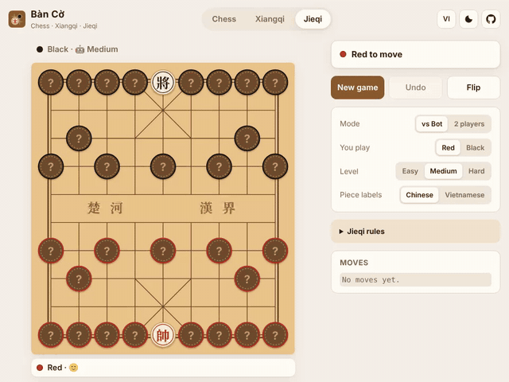
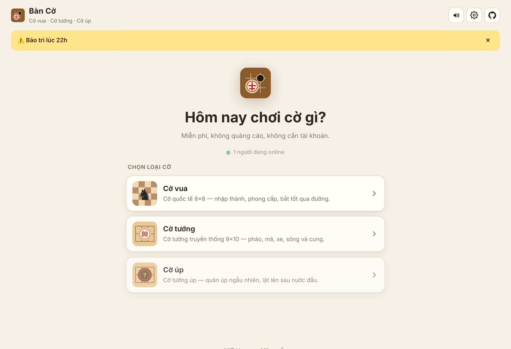
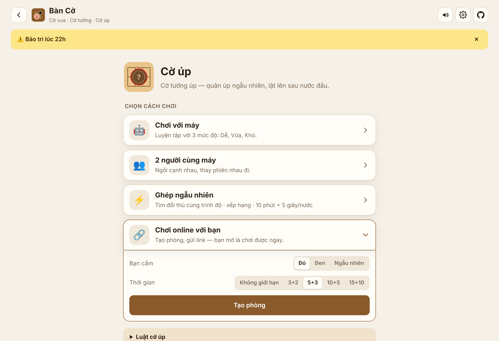
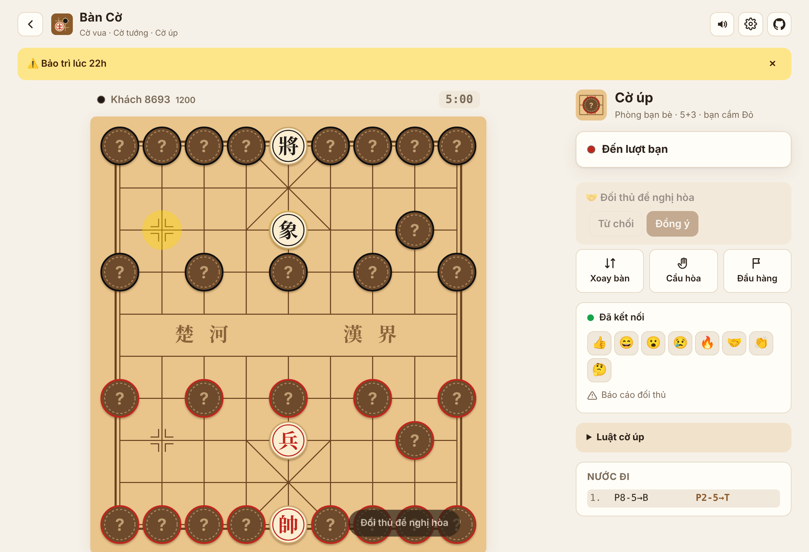
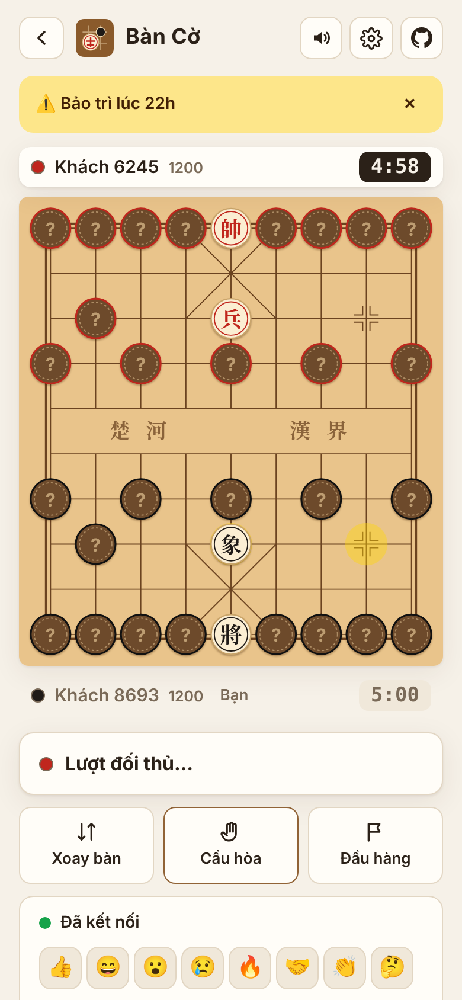
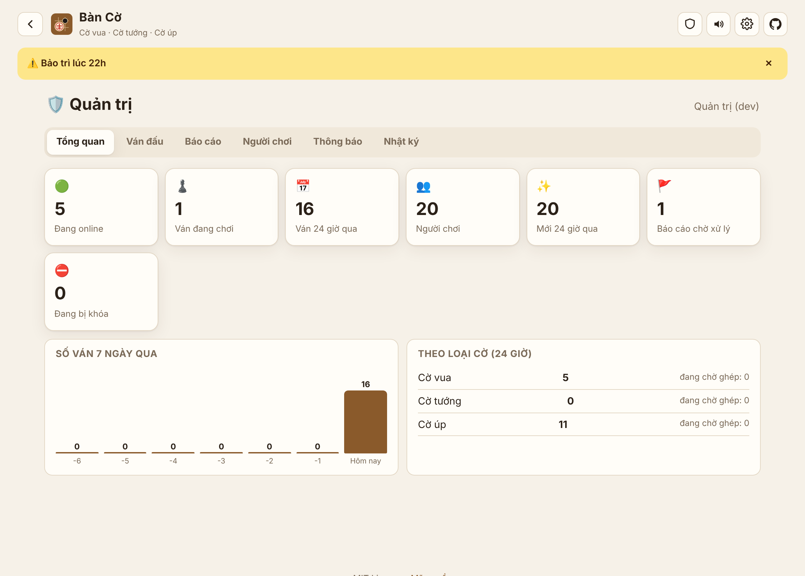
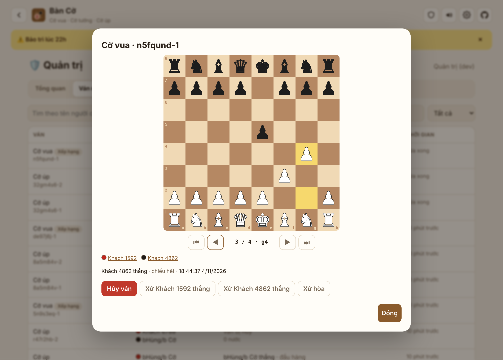
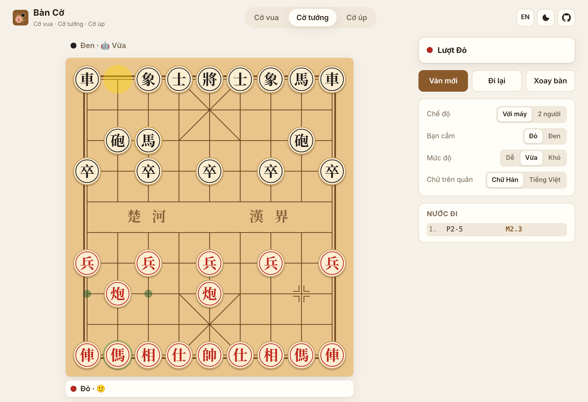
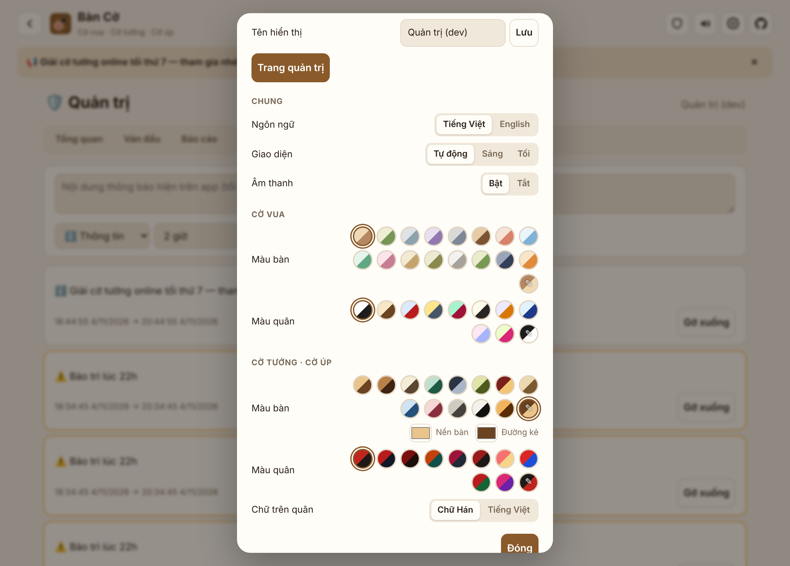

<div align="center">


# Bàn Cờ

**Chơi Cờ vua · Cờ tướng · Cờ tướng úp · Cờ vua úp ngay trên trình duyệt: với máy, với bạn, hoặc ghép ngẫu nhiên online.**

Không quảng cáo · không bắt buộc đăng ký · cài lên điện thoại như app · mã nguồn mở MIT

[**🚀 Tự chạy / Deploy**](#-bắt-đầu-nhanh) · [✨ Tính năng](#-tính-năng) · [English](#english) · [Báo lỗi / góp ý](../../issues)



</div>

## ✨ Tính năng

- ♟️ **4 loại cờ trong một app**: Cờ vua, Cờ tướng, **Cờ tướng úp (Jieqi / 揭棋)** và **Cờ vua úp**, một biến thể cùng tinh thần cờ úp cho cờ vua. Rất hiếm có bản mã nguồn mở nào chơi được cờ úp.
- ⚡ **Ghép ngẫu nhiên có xếp hạng (Elo)**: app tìm đối thủ có điểm gần nhất. Mỗi ván 10 phút, cộng 5 giây sau mỗi nước.
- 🔗 **Chơi với bạn qua link**: tạo phòng, chọn màu quân và thời gian (không giới hạn, 3+2, 5+3, 10+5, 15+10), rồi gửi link qua Zalo hay Messenger. Ai vào khi phòng đã đủ người sẽ được xem ván.
- 🛡️ **Máy chủ giữ ván cờ**:
  - Kiểm tra mọi nước đi, nên không thể gian lận bằng cách sửa code trên trình duyệt.
  - Mất mạng hay tải lại trang vẫn vào lại được ván.
  - Ở cờ úp, trình duyệt **không biết trước** quân úp là gì. Máy chủ chỉ báo khi quân được lật.
- ⏱️ **Đồng hồ thi đấu cho mọi chế độ** (cả chơi với máy và 2 người cùng máy), đủ các kiểu cộng giờ:
  - **Fischer** (cộng giờ sau mỗi nước): 1+0, 3+2, 5+3, 10+5, 15+10, 30+20.
  - **US delay** (`5 d3`): mỗi nước đồng hồ chờ 3 giây rồi mới chạy.
  - **Bronstein** (`5 b3`): được trả lại thời gian đã dùng, tối đa 3 giây.
  - **Cổ điển FIDE** (`90/40+30 +30s`): 90 phút cho 40 nước đầu, rồi cộng thêm 30 phút, kèm 30 giây mỗi nước.
  - Có nút tạm dừng và tiếng cảnh báo khi còn dưới 10 giây. **Hết giờ là thua, trừ khi đối thủ không còn cách nào thắng thì hòa** (luật FIDE 6.9; cờ tướng: đối thủ không còn quân tấn công).
- 🤝 Online có thêm: cầu hòa, đầu hàng, chơi lại (tự đổi màu quân), biểu tượng cảm xúc.
- 🚪 **Đối thủ bỏ đi**: sau 60 giây bạn được bấm xử thắng. Sau 5 phút máy chủ tự xử.
- 🚩 **Báo cáo người chơi**: gian lận, xúc phạm, cố tình kéo dài, tên không phù hợp.
- 👤 **Tài khoản**: chơi ngay với tư cách khách. Đăng nhập Google nếu muốn giữ điểm và lịch sử khi đổi máy.
- 🧑‍⚖️ **Trang quản trị toàn quyền**:
  - Thống kê: người online, số ván, biểu đồ 7 ngày.
  - Xem ván đang chơi và xem lại từng nước, kể cả quân úp.
  - Hủy ván, xử thắng/hòa.
  - Xử lý báo cáo.
  - Cảnh cáo, khóa có thời hạn hoặc vĩnh viễn, đổi tên, chỉnh điểm, cấp quyền quản trị, xóa tài khoản.
  - Đăng thông báo toàn hệ thống, hiện ngay trên máy người chơi.
  - Nhật ký mọi thao tác của quản trị viên.
- 🧩 **126 màn giải thế cờ** (63 cờ vua, 63 cờ tướng): chiếu hết sau 1, 2, 3 nước, từ dễ đến khó.
  - Mở khóa lần lượt từng màn, có sao đánh giá, gợi ý, làm lại và xem đáp án.
  - Đối thủ luôn chống cự theo cách khó nhất.
  - Mọi thế cờ do chính engine của app tìm ra qua các ván tự đấu, rồi được kiểm tra vét cạn: chiếu hết được đúng số nước đã ghi, không có cách nhanh hơn, và nước đầu là duy nhất.
- 🤖 **Máy chơi cùng** với 4 mức Dễ / Vừa / Khó / Rất khó, chạy trong Web Worker nên không giật.
  - Thuật toán: PVS, aspiration window, bảng chuyển vị, null-move pruning, late move reductions, check extension, quiescence search.
  - Hàm đánh giá: cấu trúc tốt, tốt thông, cặp Tượng, Xe cột mở, độ linh hoạt của quân, an toàn Vua/Tướng.
  - **Đo thực tế:** đấu 20 ván với bot đời trước, cùng 150 ms mỗi nước. Cờ vua thắng 17, hòa 2, thua 1; cờ tướng thắng 16, hòa 4, không thua. Mạnh hơn khoảng **+380 Elo** ở cả hai.
  - **Elo cờ vua ước lượng**: cho từng mức đấu với Stockfish 19 ở chế độ giới hạn sức mạnh (`UCI_Elo`), mỗi bên cùng thời gian mỗi nước.

    | Mức | Thời gian/nước | Kết quả | Elo ước lượng |
    |---|---|---|---|
    | Dễ | 0,25 s | +1 =1 −10 trước Stockfish 1320 | ~1000 (dưới mức thấp nhất của Stockfish, rất không chắc) |
    | Vừa | 0,7 s | +8 =1 −3 trước Stockfish 1900 | ~2050 |
    | Khó | 2 s | +6 =1 −1 trước Stockfish 2200 | ~2450 |
    | Rất khó | 5 s | chưa đo trực tiếp | cao hơn Khó, khoảng +50 đến +100 |

    Cách hiểu: mỗi mức chỉ đấu 8–12 ván nên sai số còn lớn (±150–250 Elo). Stockfish khi bị giới hạn sức mạnh chơi yếu hơn mức ghi danh ở thời gian ngắn, nên các con số có thể **cao hơn** Elo thật trên Lichess/Chess.com. Cờ tướng và cờ úp chưa có thang Elo chuẩn để so.
- 🎬 **Máy đấu máy để xem và học**:
  - Chọn mức độ cho từng bên và tốc độ (chậm / vừa / nhanh), có tạm dừng và đi từng nước.
  - Rời trang (ví dụ để phân tích ván) rồi quay lại vẫn xem tiếp đúng ván đó.
  - **Thanh đánh giá** cho biết bên nào hơn và hơn bao nhiêu, hoặc "chiếu hết sau N nước".
  - Xem **chuỗi nước máy dự tính**.
  - **Nhận xét từng nước**: ✓ tốt nhất, ?! không chính xác, ? sai lầm, ?? sai lầm nghiêm trọng. Nhận xét do một máy trọng tài cố định chấm, nên nhất quán dù hai bên chơi ở mức nào.
- 📈 **Phân tích ván sau khi chơi** (nút "Phân tích ván" ở cuối mỗi ván, cả chơi online và máy đấu máy):
  - Máy chấm **từng nước**: ✓ tốt nhất, ?! không chính xác, ? sai lầm, ?? sai lầm nghiêm trọng.
  - Gặp nước sai, máy chỉ ra **nước tốt hơn**. **Mũi tên xanh** chỉ nước tốt nhất ở thế cờ đang xem, kèm diễn biến dự tính.
  - **Biểu đồ ưu thế** cả ván: bấm vào đâu thì nhảy tới thế cờ đó.
  - **Độ chính xác (%)** và số lỗi của mỗi bên, tính theo công thức Lichess công bố.
  - Đi tới đi lui bằng nút hoặc phím ← →. Có hai mức phân tích: nhanh và kỹ.
- 🎭 **Bot cờ úp không ăn gian**: máy không biết quân úp là gì. Nó thử nhiều cách xếp ngẫu nhiên rồi chọn nước tốt nhất tính trung bình.
- ✅ **Đúng luật**:
  - Cờ vua: nhập thành, bắt tốt qua đường, phong cấp, hòa theo FIDE.
  - Cờ tướng: lộ mặt tướng, cản mã, cản tượng, pháo ngòi.
  - **Luật cấm chiếu dai và đuổi dai** theo luật châu Á (bản giản lược).
- 🎨 **Đổi màu thoải mái**:
  - Cờ vua: 16 kiểu bàn và 10 bộ màu quân.
  - Cờ tướng: 13 kiểu bàn và 10 bộ màu quân.
  - Thêm chế độ **tùy chỉnh** với bảng chọn màu bất kỳ.
- 🔊 **Âm thanh riêng cho từng quân** (tổng hợp bằng Web Audio, không cần file): Tốt kêu "tách", Xe "thịch" nặng, Hậu có tiếng chuông, Vua/Tướng có tiếng chuông trầm, Sĩ gõ nhẹ hai tiếng, Pháo "bụp" (ăn quân thì "đùng"), **Mã có tiếng ngựa hí, Tượng có tiếng voi rống**. Ăn quân có thêm tiếng "rắc". Có thể đổi sang kiểu đơn giản và nghe thử trong Cài đặt.

<table>
  <tr>
    <td></td>
    <td></td>
  </tr>
  <tr>
    <td></td>
    <td align="center"></td>
  </tr>
  <tr>
    <td></td>
    <td></td>
  </tr>
  <tr>
    <td></td>
    <td></td>
  </tr>
</table>

## ♟️ Luật cờ vua úp

1. Xếp như cờ vua, nhưng mọi quân trừ Vua đều **úp mặt và bị xáo ngẫu nhiên** giữa 15 ô xuất phát của bên mình. Hậu có thể đứng ở ô Tốt, Tốt có thể ở hàng cuối.
2. Quân úp đi theo quân **vốn đứng ở ô đó**. Úp ở ô Tốt thì đi như Tốt (lên 1 hoặc 2 ô, ăn chéo); úp ở ô Mã thì đi như Mã.
3. Đi xong nước đầu, quân được **lật lên** và từ đó đi đúng loại thật của nó.
4. Vẫn **nhập thành** được với quân úp ở góc bàn (nó đi như Xe). Quân đó lật lên sau khi nhập thành.
5. Tốt lật lên ở hàng cuối của bên mình chỉ đi lên 1 ô. **Bắt tốt qua đường** chỉ áp dụng khi quân vừa đi 2 ô đúng là Tốt.
6. Phong cấp, chiếu hết, hết nước (pat) và các luật hòa khác như cờ vua thường. Còn quân úp thì không bao giờ xử hòa vì thiếu quân.

Bot không nhìn trộm quân úp. Khi chơi online, máy chủ giấu danh tính quân úp, chỉ cho biết khi quân được lật. Trong FEN, quân úp được viết với dấu `~` phía trước (ví dụ `~N` là quân úp mà thật ra là Mã).

## 🀄 Luật cờ tướng úp

1. Xếp quân như cờ tướng, nhưng mọi quân trừ Tướng đều **úp mặt và bị xáo trộn ngẫu nhiên**. Mỗi bên xáo quân của mình.
2. Quân úp đi theo luật của quân **vốn đứng ở ô đó**. Ví dụ: quân úp ở chỗ Pháo thì đi như Pháo.
3. Sau nước đi đầu tiên, quân được **lật lên**. Từ đó nó đi đúng theo loại thật của mình.
4. Sĩ và Tượng đã lật được đi khắp bàn, không bị giới hạn trong cung hay bên sông.
5. Bị chiếu hết hoặc hết nước đi là thua.

## 🏗️ Kiến trúc

```
Trình duyệt (Vite + TypeScript, không framework)
  │  REST /api/*  +  WebSocket
  ▼
Cloudflare Worker (server/index.ts): API, đăng nhập, phục vụ app
  ├─ Durable Object "GameRoom" (mỗi phòng một bản): giữ ván, kiểm tra nước đi bằng chính bộ luật của app,
  │   đồng hồ, giấu quân úp, ghi kết quả
  ├─ Durable Object "Lobby" (một bản): người online, hàng chờ ghép trận, thông báo trực tiếp
  └─ D1 (SQLite): users · games · reports · announcements · audit
```

Chế độ chơi với máy và 2 người chạy hoàn toàn trên trình duyệt, không cần máy chủ.

## 🚀 Bắt đầu nhanh

### 1. Chơi trên máy của bạn: làm một lần, khoảng 5 phút

**Bước 1: Cài Node.js.** Vào [nodejs.org](https://nodejs.org), tải bản **LTS** (bản 20 trở lên) và cài như phần mềm bình thường: bấm *Next* đến hết. Cài xong thì **tắt hết cửa sổ terminal đang mở**, để máy nhận Node.js.

**Bước 2: Tải code về.** Chọn một trong ba cách:
- **Không cần tài khoản:** bấm nút xanh **Code → Download ZIP** ở đầu trang này. Sau đó **giải nén**: chuột phải vào file ZIP → *Extract All*. Bạn sẽ có thư mục `banco-chess-main`.
- **GitHub Desktop:** *File → Clone repository → URL*, dán `https://github.com/lethienloc2004/banco-chess`, rồi bấm *Clone*.
- **Dòng lệnh:** `git clone https://github.com/lethienloc2004/banco-chess.git`

**Bước 3: Mở terminal ngay trong thư mục code.**
- **Windows:** mở thư mục code. Bấm vào thanh địa chỉ ở trên cùng, xóa hết chữ, gõ `cmd` rồi Enter. Cửa sổ đen hiện ra là đúng chỗ.
- **GitHub Desktop:** *Repository → Open in Command Prompt* (hoặc *Open in Terminal*).
- **macOS:** chuột phải vào thư mục → *Services → New Terminal at Folder*.

> Trên Windows nên dùng **Command Prompt (cmd)**. PowerShell có thể báo lỗi "running scripts is disabled".

**Bước 4: Cài và chạy.** Gõ lần lượt từng lệnh, mỗi lệnh bấm Enter rồi chờ nó chạy xong:

```bash
npm ci
```

```bash
npm start
```

Lệnh đầu tải các thư viện cần thiết, mất 1–2 phút. Khi lệnh thứ hai hiện dòng **🎉 Mở http://localhost:8787 để chơi**, bạn mở trình duyệt và vào **http://localhost:8787**.

Thế là chơi được tất cả các tính năng: chơi với máy, máy đấu máy, giải thế cờ, phân tích ván, chơi online và trang quản trị.
- **Thử chơi online:** mở thêm một cửa sổ ẩn danh (Ctrl+Shift+N) để làm người chơi thứ hai.
- **Thử trang quản trị:** vào **Cài đặt → Đăng nhập quản trị (chỉ khi phát triển)**.
- **Chơi trên điện thoại hoặc rủ bạn bè:** bản chạy trên máy chỉ mở được trên chính máy đó. Muốn có link cho người khác vào thì đưa lên mạng ở bước 2.

#### Những lần sau

| Muốn… | Làm thế nào |
|---|---|
| **Dừng app** | Bấm vào cửa sổ terminal rồi nhấn **Ctrl + C**. Nếu được hỏi thì gõ `Y` rồi Enter |
| **Chơi lại** | Mở terminal trong thư mục code như bước 3, gõ `npm start` (không cần `npm ci` nữa) |
| **Cập nhật bản mới** | GitHub Desktop: bấm **Pull origin**. Tải ZIP: tải lại và giải nén. Dòng lệnh: `git pull`. Sau đó dừng app, chạy `npm ci` rồi `npm start` |

#### Gặp lỗi khi chạy trên máy?

| Báo lỗi | Cách xử lý |
|---|---|
| `'npm' is not recognized…` / `npm: command not found` | Chưa cài Node.js, hoặc chưa mở lại terminal sau khi cài. Làm lại bước 1 |
| `running scripts is disabled on this system` | Bạn đang dùng PowerShell. Mở **Command Prompt (cmd)** như bước 3 rồi chạy lại |
| `EPERM: operation not permitted … esbuild.exe` | App vẫn đang chạy ở một cửa sổ khác. Nhấn Ctrl+C ở cửa sổ đó, hoặc chạy `taskkill /F /IM node.exe`, rồi chạy lại lệnh. Vẫn lỗi thì xóa thư mục `node_modules` và chạy lại `npm ci` |
| `Address already in use` / cổng `8787` đã được dùng | App đã chạy sẵn ở cửa sổ khác: cứ mở http://localhost:8787, hoặc dừng cửa sổ đó trước |
| GitHub Desktop không cho **Pull** vì `package-lock.json` | Chuột phải file đó → **Discard changes**, rồi Pull lại. Lần sau dùng `npm ci` thay cho `npm install` để file này không bị sửa |
| Terminal hiện `Unable to fetch the Request.cf object` hoặc `Request was cancelled` | Chỉ là cảnh báo khi mạng chậm hoặc bị chặn. Bỏ qua được, app vẫn chạy bình thường |
| Cập nhật rồi mà trang vẫn hiện bản cũ | Nhấn **Ctrl + F5** để tải lại hẳn |
| `npm ci` báo lỗi mạng / `ETIMEDOUT` | Kiểm tra kết nối mạng rồi chạy lại. Mạng công ty/trường có thể chặn, hãy thử mạng khác |

### 2. Đưa lên mạng thành bản của riêng bạn (miễn phí)

Bạn cần một tài khoản [Cloudflare](https://dash.cloudflare.com/sign-up) miễn phí. Sau đó chọn **một** trong hai cách.

#### Cách A: một lệnh, trả lời 3 câu hỏi *(khuyên dùng)*

```bash
npm run setup
```

| Câu hỏi | Điền gì | Ví dụ |
|---|---|---|
| **Tên app** | Tên dùng trong địa chỉ web: chữ thường, số, dấu gạch ngang | `co-tuong-cua-toi` |
| **Email quản trị** | Email Google của bạn. Đăng nhập bằng email này là có trang quản trị | `ban@gmail.com` |
| **Google Client ID** | Có thể bỏ trống (bấm Enter). Chỉ cần nếu muốn có nút "Đăng nhập Google", xem [mục bên dưới](#đăng-nhập-google-tùy-chọn) | `1234-abc.apps.googleusercontent.com` |

Phần còn lại script tự làm:
- Mở trình duyệt để bạn đăng nhập Cloudflare.
- Tạo cơ sở dữ liệu.
- Tạo khóa bí mật ngẫu nhiên.
- Build và đưa app lên mạng.
- In ra link dạng `https://co-tuong-cua-toi.<tài-khoản>.workers.dev`.

Chạy lại `npm run setup` bao nhiêu lần cũng được: script dùng lại những gì đã có và **không** làm người chơi bị đăng xuất.

#### Cách B: nút bấm, không cần cài gì trên máy

[](https://deploy.workers.cloudflare.com/?url=https://github.com/lethienloc2004/banco-chess)

1. Bấm nút trên và đăng nhập Cloudflare. Cloudflare sẽ tạo một bản sao của dự án trên GitHub của bạn, kèm cơ sở dữ liệu.
2. Khi được hỏi **AUTH_SECRET**, điền một chuỗi ngẫu nhiên dài bất kỳ, ví dụ gõ bừa khoảng 40 ký tự. Đừng chia sẻ chuỗi này cho ai.
3. Muốn làm quản trị viên: trong bản sao trên GitHub của bạn, sửa file `wrangler.toml`, điền email vào dòng `ADMIN_EMAILS = ""` rồi commit. Cloudflare sẽ tự deploy lại.

> Nút này là tính năng của Cloudflare. Nếu bước tự tạo cơ sở dữ liệu báo lỗi, hãy dùng Cách A.

### 3. Tùy chỉnh và cập nhật

| Muốn… | Làm thế nào |
|---|---|
| Thêm / bớt quản trị viên | Sửa `ADMIN_EMAILS` trong `wrangler.toml` rồi `npm run deploy`. Hoặc vào **Trang quản trị → Người chơi → Cấp quyền quản trị** |
| Bật đăng nhập Google | Điền `GOOGLE_CLIENT_ID` trong `wrangler.toml` (hoặc chạy lại `npm run setup`) |
| Nút GitHub trong app trỏ về repo của bạn | Sửa `"repository"` trong `package.json` |
| Dùng tên miền riêng | Cloudflare Dashboard → **Workers & Pages** → app của bạn → **Settings → Domains & Routes** |
| Cập nhật code mới lên mạng | `npm run deploy` |
| Tự deploy mỗi khi push lên GitHub | Thêm 2 secret `CLOUDFLARE_API_TOKEN` và `CLOUDFLARE_ACCOUNT_ID` vào **Settings → Secrets and variables → Actions** của repo. Token tạo tại [Cloudflare API Tokens](https://dash.cloudflare.com/profile/api-tokens) bằng mẫu *Edit Cloudflare Workers*, thêm quyền *D1 Edit* |

#### Đăng nhập Google (tùy chọn)

1. Vào [Google Cloud Console → Credentials](https://console.cloud.google.com/apis/credentials) → **Create credentials → OAuth client ID** → chọn loại **Web application**.
2. Ở **Authorized JavaScript origins**, thêm link app của bạn, ví dụ `https://co-tuong-cua-toi.ten-ban.workers.dev`. Muốn đăng nhập khi chạy thử trên máy thì thêm cả `http://localhost:8787`.
3. Copy **Client ID**, điền vào `GOOGLE_CLIENT_ID` trong `wrangler.toml`, rồi chạy `npm run deploy`.

#### Gặp lỗi?

| Hiện tượng | Cách xử lý |
|---|---|
| App báo "Không kết nối được máy chủ" | Máy chủ chưa có khóa bí mật: chạy lại `npm run setup` |
| Không thấy biểu tượng khiên 🛡️ | Bạn phải **đăng nhập Google** bằng đúng email trong `ADMIN_EMAILS`, và email đó đã được deploy (`npm run deploy`) |
| Nút "Đăng nhập Google" không hiện | `GOOGLE_CLIENT_ID` đang trống |
| Bấm đăng nhập Google báo lỗi | Link app chưa có trong *Authorized JavaScript origins* |
| `npm run setup` báo lỗi đăng nhập | Chạy `npx wrangler login` rồi chạy lại setup |

Gói miễn phí của Cloudflare thường đủ cho một cộng đồng nhỏ. Giới hạn cụ thể xem tại [trang giá Workers](https://developers.cloudflare.com/workers/platform/pricing/).

### Dành cho người đóng góp code

```bash
npm run dev          # Vite tự tải lại khi sửa giao diện (http://localhost:5173), chạy cùng: npm run dev:server
npm test             # luật cờ (perft), chiếu dai, đăng nhập, bot, script cài đặt
npm run test:server  # kiểm tra máy chủ: phòng, ghép trận, xếp hạng, quản trị (khi npm start đang chạy)
```

## 🧠 Cấu trúc mã nguồn

```
src/
  engine/         Luật cờ vua (0x88), cờ tướng + cờ úp, tìm kiếm alpha-beta, bot
  game.ts         Ván cờ: lịch sử, đi lại, lặp thế, chiếu dai/đuổi dai, lật quân úp theo máy chủ
  shared/         Giao thức và kiểu dữ liệu dùng chung cho app và máy chủ
  net.ts          Gọi API, tài khoản, WebSocket tự kết nối lại
  puzzles/        Dữ liệu thế cờ, bộ giải chiếu hết vét cạn, tiến độ người chơi
  analysis.ts     Chấm nước đi và độ chính xác cho phần phân tích ván
  ui/             Màn hình: trang chủ, chọn cách chơi, ván cờ, ghép trận, quản trị, hộp thoại, màu, giải thế cờ, phân tích ván
server/
  index.ts        API: đăng nhập khách/Google, phòng, báo cáo
  room.ts         Durable Object phòng chơi
  lobby.ts        Durable Object sảnh chờ / ghép trận
  admin.ts        API quản trị
  auth.ts         Ký phiên (HMAC) và xác minh Google ID token
migrations/       Lược đồ cơ sở dữ liệu D1
scripts/          npm start, npm run setup, generate-puzzles.ts (tạo thế cờ mới)
tests/            Perft chuẩn, luật, đăng nhập, bot, kiểm tra mọi thế cờ; tests/e2e: kiểm tra máy chủ
```

## 🔒 Bảo mật & giới hạn hiện tại

- Mọi nước đi online đều được máy chủ kiểm tra. Quân úp chỉ được tiết lộ khi lật. Tên người chơi được làm sạch và luôn được escape khi hiển thị.
- Tài khoản khách gắn với trình duyệt. Người bị khóa có thể tạo tài khoản khách mới. Muốn chặn chặt hơn, có thể chỉ cho tài khoản Google chơi xếp hạng; đây là một ý tưởng đóng góp.
- Luật cấm đuổi dai là bản giản lược: chỉ xét quân vừa đi tấn công một quân không được bảo vệ, hoặc quân có giá trị lớn hơn. Các trường hợp đặc biệt của luật châu Á đầy đủ chưa được xử lý.
- Chống dùng máy hỗ trợ trong lúc chơi chỉ dựa vào báo cáo và xem lại ván. App chưa tự động phát hiện.

## 📚 Nguồn tham khảo & ghi công

Toàn bộ mã nguồn được viết mới, **không dùng thư viện cờ nào**. Kiến thức và dữ liệu tham khảo:

- **Luật cờ vua**: [Luật cờ vua FIDE (FIDE Laws of Chess)](https://handbook.fide.com): nhập thành, bắt tốt qua đường, phong cấp, lặp thế cờ, hòa.
- **Luật cờ tướng**: luật thi đấu phổ biến (châu Á / WXF), kể cả cấm chiếu dai và đuổi dai (bản giản lược). Luật cờ úp theo cách chơi Jieqi phổ biến.
- **Kỹ thuật lập trình cờ** từ [Chess Programming Wiki](https://www.chessprogramming.org):
  - [bàn cờ 0x88](https://www.chessprogramming.org/0x88)
  - [alpha-beta](https://www.chessprogramming.org/Alpha-Beta)
  - [quiescence search](https://www.chessprogramming.org/Quiescence_Search)
  - [Zobrist hashing](https://www.chessprogramming.org/Zobrist_Hashing)
  - [killer heuristic](https://www.chessprogramming.org/Killer_Heuristic) và [history heuristic](https://www.chessprogramming.org/History_Heuristic)
  - [PVS](https://www.chessprogramming.org/Principal_Variation_Search) và [aspiration windows](https://www.chessprogramming.org/Aspiration_Windows)
  - [null-move pruning](https://www.chessprogramming.org/Null_Move_Pruning) và [late move reductions](https://www.chessprogramming.org/Late_Move_Reductions)
  - [reverse futility pruning](https://www.chessprogramming.org/Reverse_Futility_Pruning) và [mate distance pruning](https://www.chessprogramming.org/Mate_Distance_Pruning)
  - MVV-LVA
- **Bảng điểm vị trí quân cờ vua** (piece-square tables) dựa trên [Simplified Evaluation Function](https://www.chessprogramming.org/Simplified_Evaluation_Function) của Tomasz Michniewski.
- **Số liệu perft để kiểm tra luật**:
  - Cờ vua: từ trang [Perft Results](https://www.chessprogramming.org/Perft_Results).
  - Cờ tướng: số liệu thế khởi đầu được các engine cờ tướng công bố (44 / 1 920 / 79 666).
- **Bot cờ úp** dùng ý tưởng [Perfect Information Monte Carlo](https://www.chessprogramming.org/Monte-Carlo_Tree_Search): lấy mẫu các cách xếp quân úp rồi tìm kiếm trên từng mẫu.
- **Độ chính xác khi phân tích ván**: công thức tỉ lệ thắng và độ chính xác mà [Lichess công bố](https://lichess.org/page/accuracy).
- **Xếp hạng**: [hệ số Elo](https://en.wikipedia.org/wiki/Elo_rating_system), K = 32.
- **Máy chủ**: [Cloudflare Workers, Durable Objects và D1](https://developers.cloudflare.com/).
- **Đăng nhập Google**: [Google Identity Services](https://developers.google.com/identity/gsi/web).
- **Font** chữ Hán trên quân: [Noto Serif SC](https://fonts.google.com/noto/specimen/Noto+Serif+SC) (SIL Open Font License), tải qua Google Fonts.
- Quân cờ vua hiển thị bằng ký tự Unicode (♔♕♖♗♘♙), dùng font có sẵn trên máy.

## 🤝 Đóng góp

Mọi đóng góp đều được hoan nghênh! Một vài ý tưởng:

- [ ] Thêm thế cờ: chạy `npx tsx scripts/generate-puzzles.ts` để tìm thế mới (dạng chiếu hết, ăn quân, chiếu dai…)
- [ ] Phân tích ván sau khi chơi, gợi ý nước đi
- [ ] Bảng xếp hạng công khai, trang hồ sơ người chơi
- [ ] Giải đấu / phòng chờ nhiều bàn
- [ ] Phát hiện dùng máy hỗ trợ (so độ chính xác với bot)
- [ ] Thêm biến thể: Chess960, cờ úp với luật biến thể…
- [ ] Bot mạnh hơn (bitboard, NNUE…)

Fork → tạo nhánh → `npm test` → mở Pull Request.

Nếu thấy hay, hãy cho dự án một ⭐ nhé!

---

## English

**Bàn Cờ** ("chess board" in Vietnamese) is a web app to play **Chess**, **Xiangqi** (Chinese chess), **Jieqi**
(揭棋, xiangqi with face-down pieces) and **Hidden chess** (the same idea for chess): against a built-in bot, with a
friend on the same device, or online. The whole interface is available in Vietnamese and English.

- **Online on Cloudflare** (Workers + Durable Objects + D1): rated quick matchmaking (Elo), friend rooms via link,
  spectators, clocks, draw offers, rematch, emotes, reports, reconnect after reloads, abandonment claims.
- **Authoritative server**: every move is validated with the same rules engine; in Jieqi and Hidden chess the client
  never learns a face-down piece before it is revealed.
- **Accounts**: play instantly as a guest, optionally sign in with Google.
- **Full admin dashboard**:
  - Stats, live games and replays (face-down pieces shown to admins).
  - Cancel games or set results.
  - Handle reports.
  - Manage players: warn, ban, rename, set rating, change roles, delete.
  - Post live announcements.
  - Audit log of every admin action.
- **Rules**: castling, en passant, promotion, FIDE draws; flying general, blocked horse/elephant, cannon screens,
  Asian-rules perpetual check / chase (simplified). Verified with standard perft counts.
- **Clocks in every mode**: Fischer increment (1+0 … 30+20), US delay (`5 d3`), Bronstein delay (`5 b3`) and FIDE
  classical `90/40+30 +30s`, with pause and a low-time beep. Losing on time follows FIDE 6.9 (a draw if the opponent
  cannot possibly checkmate).
- **Stronger engine** (PVS, null move, LMR, aspiration windows, richer evaluation) with four levels up to Expert:
  +17 =2 −1 in chess, +16 =4 −0 in xiangqi and +12 =7 −1 in jieqi against the previous version (+215 to +380 Elo).
  Rough chess Elo against limited-strength Stockfish 19: Easy ~1000, Medium ~2050, Hard ~2450 (small samples, likely optimistic).
- **Bot vs bot** watch mode with an evaluation bar, expected line and per-move quality marks from a fixed referee engine.
- **Post-game analysis** ("Analyse game" after any game, online games and bot-vs-bot included):
  - Every move is marked, from best to blunder, and mistakes come with the better move.
  - A green arrow shows the best move in the position on screen.
  - A clickable advantage graph covers the whole game.
  - Accuracy per side uses the formulas Lichess publishes.
  - Step through with the buttons or the ← → keys, at quick or deep analysis.
- **126 puzzles**: mate-in-1/2/3 levels for chess and xiangqi with stars, hints and solutions, all proven unique forced mates.
- **Sounds per piece**, synthesized with Web Audio: pawn tick, rook thud, queen chime, king bell, cannon pop / boom,
  a horse whinny for knights and an elephant trumpet for elephants and bishops (both are "Tượng" in Vietnamese).
- Many board/piece colour themes plus a custom colour picker, dark mode, installable PWA.

Install [Node.js](https://nodejs.org) 20+ (LTS), download the code (**Code → Download ZIP** and unzip, or `git clone`),
open a terminal in that folder (on Windows use Command Prompt, not PowerShell), then:

```bash
npm ci             # install dependencies (first time and after each update)
npm start          # play locally at http://localhost:8787 (Ctrl+C to stop)
npm run setup      # put your own copy online on Cloudflare: answers 3 questions, does the rest
```

Or use the **Deploy to Cloudflare** button above. Details (Google sign-in, admins, custom domain, troubleshooting)
are in the *Bắt đầu nhanh* section.

All code is original (no chess libraries). Techniques from the [Chess Programming Wiki](https://www.chessprogramming.org);
chess piece-square tables based on Tomasz Michniewski's *Simplified Evaluation Function*; perft reference numbers from
the wiki's *Perft Results* page. See *Nguồn tham khảo & ghi công* above for the full list.

Licensed under the [MIT License](LICENSE).
