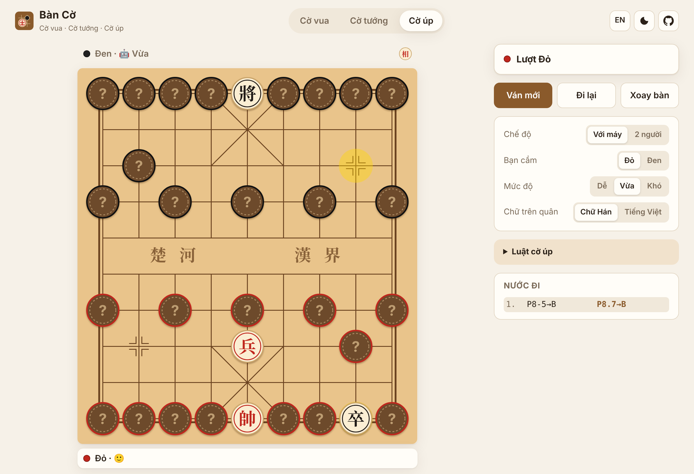
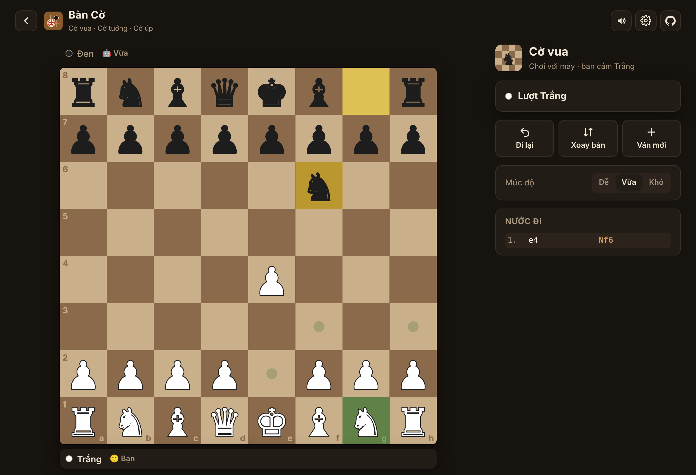
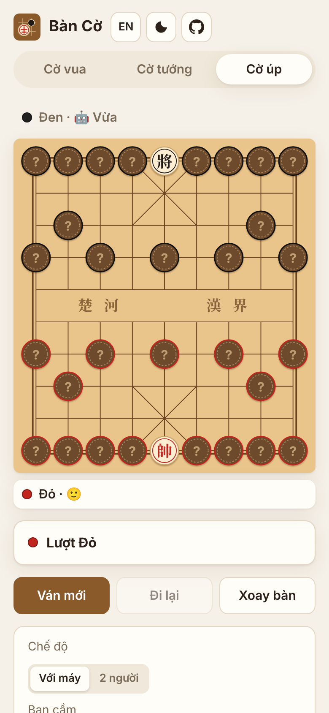

<div align="center">


# Bàn Cờ

**Chơi Cờ vua · Cờ tướng · Cờ tướng úp ngay trên trình duyệt — có máy chơi cùng.**

Không quảng cáo · không cần tài khoản · chạy được offline · cài lên điện thoại như app

[**▶ Chơi ngay**](#) · [English](#english) · [Báo lỗi / góp ý](../../issues)


</div>

## ✨ Tính năng

- ♟️ **3 loại cờ trong một app**: Cờ vua, Cờ tướng, và **Cờ tướng úp (Jieqi / 揭棋)** — rất hiếm bản mã nguồn mở chơi được.
- 🤖 **Máy chơi cùng** với 3 mức Dễ / Vừa / Khó (alpha-beta, quiescence, bảng chuyển vị), chạy trong Web Worker nên không giật.
- 🎭 **Bot cờ úp không ăn gian**: máy không biết quân úp là gì — nó thử nhiều cách xếp ngẫu nhiên rồi chọn nước tốt nhất trung bình.
- ✅ **Đúng luật**: nhập thành, bắt tốt qua đường, phong cấp (chọn Hậu/Xe/Tượng/Mã), lộ mặt tướng, cản mã, cản tượng, pháo ngòi, hòa do lặp thế cờ 3 lần (theo FIDE) / 50 nước / không đủ quân (kể cả các Tượng cùng màu ô).
- 📝 Ghi biên bản kiểu Việt Nam (`P2-5`, `M8.7`) hoặc WXF (`C2=5`), SAN cho cờ vua (`Nf3`, `O-O`, `Qxf7#`).
- 🀄 Chữ trên quân: **chữ Hán** hoặc **tiếng Việt** (Xe, Mã, Pháo…).
- 🎨 **Đổi màu bàn cờ và quân cờ**: 5 kiểu bàn và 4 bộ màu quân cho mỗi loại cờ, tự lưu lựa chọn.
- 🔊 Âm thanh đi quân, ăn quân, chiếu, lật quân úp (tổng hợp bằng Web Audio, bật/tắt được).
- 📱 Responsive, chế độ tối, tiếng Việt / English, tự lưu ván đang chơi, cài được (PWA).
- 🪶 Siêu nhẹ: không dùng framework, tổng cộng khoảng 25 KB (gzip).

<table>
  <tr>
    <td></td>
    <td></td>
  </tr>
  <tr>
    <td></td>
    <td align="center"></td>
  </tr>
</table>

## 🀄 Luật cờ tướng úp

1. Xếp quân như cờ tướng, nhưng mọi quân trừ Tướng đều **úp mặt và xáo trộn ngẫu nhiên** (mỗi bên xáo quân của mình).
2. Quân úp đi theo luật của quân **vốn đứng ở ô đó** (úp ở chỗ Pháo thì đi như Pháo).
3. Đi xong nước đầu tiên, quân được **lật lên** và từ đó đi đúng loại thật của nó.
4. Sĩ và Tượng đã lật được đi khắp bàn (không bị giới hạn trong cung / bên sông).
5. Bị chiếu hết hoặc hết nước đi là thua.

## 🚀 Chạy trên máy

Cần [Node.js](https://nodejs.org) 20 trở lên.

```bash
npm install
npm run dev      # mở http://localhost:5173
npm test         # kiểm tra luật (perft) và bot
npm run build    # build ra thư mục dist/
```

Mỗi lần push lên nhánh `main`, GitHub Actions sẽ chạy test và tự deploy lên GitHub Pages
(vào **Settings → Pages → Source: GitHub Actions** để bật lần đầu).

## 🧠 Cấu trúc mã nguồn

```
src/
  engine/
    chess.ts      Luật cờ vua (bàn 0x88), FEN, SAN, đánh giá thế cờ
    xiangqi.ts    Luật cờ tướng + cờ úp, biên bản kiểu Việt / WXF
    search.ts     Alpha-beta dùng chung cho mọi loại cờ
    ai.ts         Chọn nước theo mức độ; lấy mẫu ngẫu nhiên cho cờ úp
    ai.worker.ts  Chạy bot trong Web Worker
  game.ts         Ván cờ: lịch sử, đi lại, lặp thế cờ, lưu/khôi phục
  ui/board.ts     Vẽ bàn cờ bằng SVG
  main.ts         Giao diện, điều khiển
tests/            Perft chuẩn (cờ vua & cờ tướng), luật cờ úp, bot
```

Luật được kiểm tra bằng **perft** — đếm số thế cờ ở độ sâu N và so với số chuẩn đã công bố
(ví dụ cờ vua: 197 281 ở độ sâu 4; cờ tướng: 79 666 ở độ sâu 3).

## 📚 Nguồn tham khảo & ghi công

Toàn bộ mã nguồn được viết mới, **không dùng thư viện cờ nào**. Kiến thức và dữ liệu tham khảo:

- **Luật cờ vua**: [Luật cờ vua FIDE (FIDE Laws of Chess)](https://handbook.fide.com) (nhập thành, bắt tốt qua đường, phong cấp, lặp thế cờ, hòa).
- **Luật cờ tướng**: luật thi đấu cờ tướng phổ biến (Á Châu / WXF). Luật cờ úp theo cách chơi Jieqi phổ biến;
  luật hòa của cờ tướng được giản lược (lặp thế 3 lần là hòa, chưa xử lý luật cấm chiếu dai / đuổi dai).
- **Kỹ thuật lập trình cờ** từ [Chess Programming Wiki](https://www.chessprogramming.org):
  [bàn cờ 0x88](https://www.chessprogramming.org/0x88), [alpha-beta](https://www.chessprogramming.org/Alpha-Beta),
  [quiescence search](https://www.chessprogramming.org/Quiescence_Search), [Zobrist hashing](https://www.chessprogramming.org/Zobrist_Hashing),
  [killer](https://www.chessprogramming.org/Killer_Heuristic) / [history heuristic](https://www.chessprogramming.org/History_Heuristic), MVV-LVA.
- **Bảng điểm vị trí quân cờ vua** (piece-square tables) dựa trên
  [Simplified Evaluation Function](https://www.chessprogramming.org/Simplified_Evaluation_Function) của Tomasz Michniewski.
- **Số liệu perft để kiểm tra luật**: cờ vua từ [Perft Results](https://www.chessprogramming.org/Perft_Results)
  (thế khởi đầu, Kiwipete, Position 3–5); cờ tướng từ số liệu perft thế khởi đầu được các engine cờ tướng công bố (44 / 1 920 / 79 666).
- **Bot cờ úp** dùng ý tưởng [Perfect Information Monte Carlo](https://www.chessprogramming.org/Monte-Carlo_Tree_Search)
  (lấy mẫu các cách xếp quân úp rồi tìm kiếm trên từng mẫu).
- **Font** chữ Hán trên quân: [Noto Serif SC](https://fonts.google.com/noto/specimen/Noto+Serif+SC) (SIL Open Font License), tải qua Google Fonts.
- Quân cờ vua hiển thị bằng ký tự Unicode (♔♕♖♗♘♙), dùng font có sẵn trên máy.

## 🤝 Đóng góp

Mọi đóng góp đều được hoan nghênh! Một vài ý tưởng:

- [ ] Chơi online với bạn qua link (WebRTC, không cần server)
- [ ] Gợi ý nước đi / phân tích ván sau khi chơi
- [ ] Đồng hồ thi đấu
- [ ] Thêm biến thể: Chess960, cờ úp với luật biến thể…
- [ ] Bot mạnh hơn (bitboard, NNUE…)

Fork → tạo nhánh → `npm test` → mở Pull Request.

Nếu thấy hay, hãy cho dự án một ⭐ nhé!

---

## English

**Bàn Cờ** ("chess board" in Vietnamese) is a tiny, dependency-free web app to play **Chess**,
**Xiangqi** (Chinese chess) and **Jieqi** (揭棋, "dark" xiangqi with face-down pieces) in the
browser — against a friend on the same device or against a built-in bot with three levels.

- Full rules: castling, en passant, promotion, flying general, blocked horse/elephant, cannon screens,
  draws by FIDE threefold repetition / move limit / insufficient material. Verified with standard perft counts.
- Board and piece colour themes.
- The Jieqi bot never peeks at hidden pieces: it averages searches over random arrangements of
  the unknown pieces (perfect-information Monte Carlo).
- Notation: SAN for chess, WXF (`C2=5`) or Vietnamese (`P2-5`) for xiangqi.
- Synthesized sound effects (Web Audio), PWA (installable, works offline), dark mode, Vietnamese / English UI, auto-saves your game.

```bash
npm install && npm run dev
```

All code is original (no chess libraries). Techniques from the [Chess Programming Wiki](https://www.chessprogramming.org);
chess piece-square tables based on Tomasz Michniewski's *Simplified Evaluation Function*; perft reference numbers from
the wiki's *Perft Results* page. See the Vietnamese section *Nguồn tham khảo & ghi công* above for the full list.

Licensed under the [MIT License](LICENSE).
