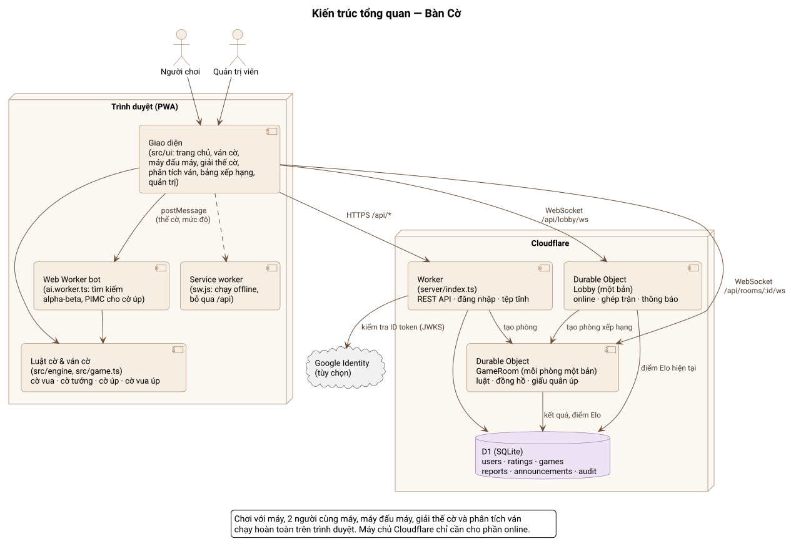
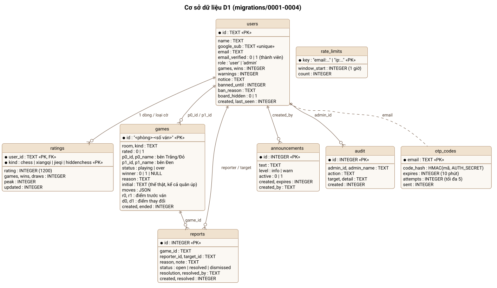
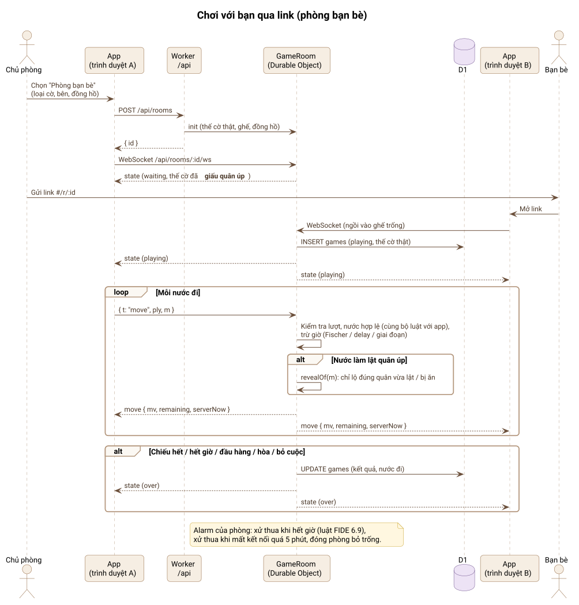
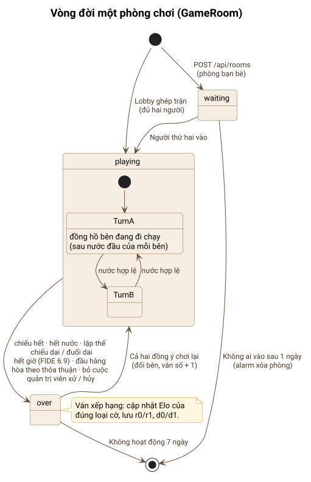
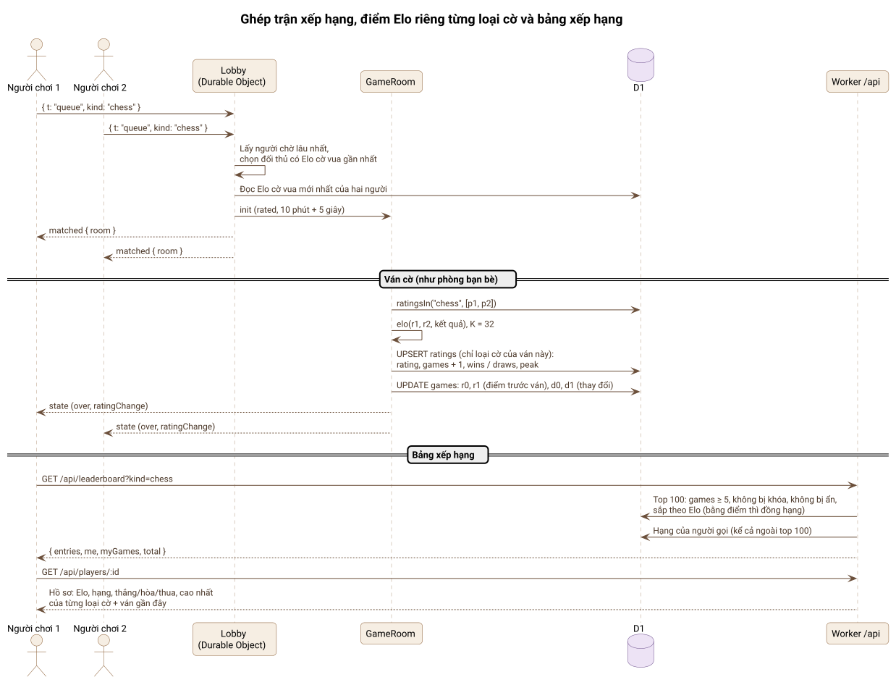
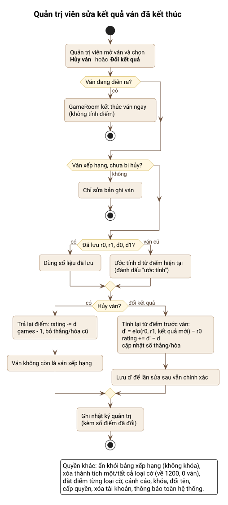
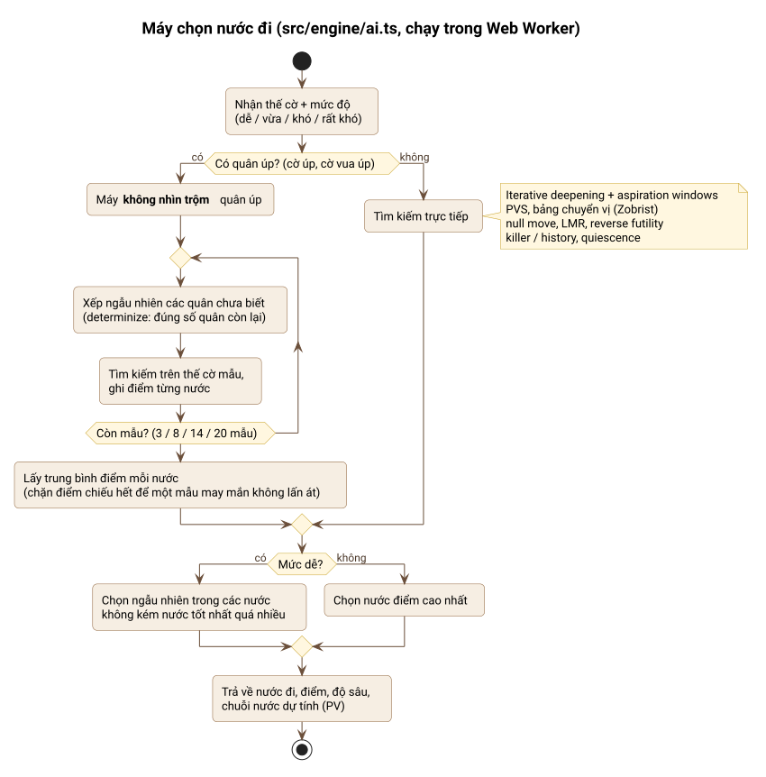
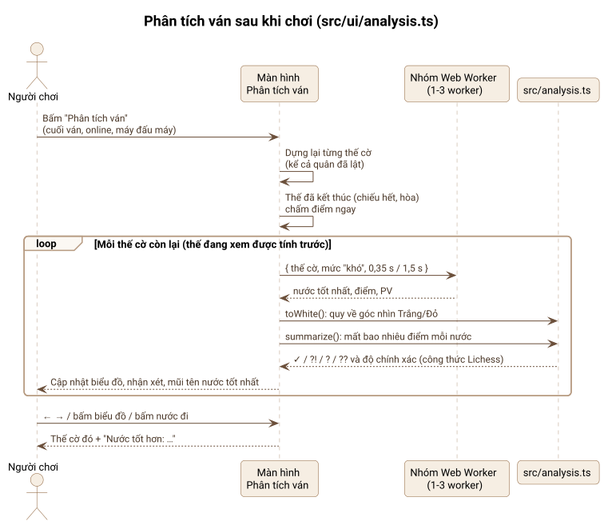
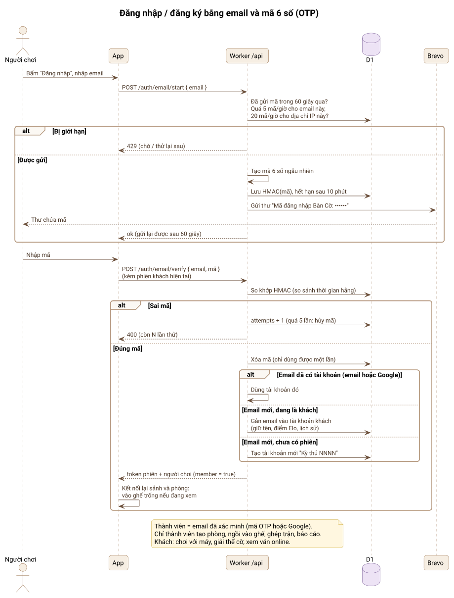

# 📐 Sơ đồ / Diagrams

Các sơ đồ viết bằng [PlantUML](https://plantuml.com). File nguồn `.puml` nằm cạnh ảnh `.svg` ở thư mục này.
*Diagrams are written in PlantUML; each `.svg` is generated from the `.puml` file next to it.*

**Sửa sơ đồ / Editing:** sửa file `.puml`, rồi chạy lệnh dưới đây (cần Java 11+, PlantUML tự tải lần đầu):

```bash
npm run diagrams
```

Muốn xem nhanh không cần cài gì: dán nội dung file `.puml` vào [plantuml.com/plantuml](https://www.plantuml.com/plantuml/uml/), nhớ chép cả `_style.iuml` thay cho dòng `!include`. Trong VS Code hay IDE JetBrains, cài plugin **PlantUML** để xem trực tiếp.
*Quick look: paste a `.puml` file into the PlantUML web server, or use the PlantUML plugin of VS Code / JetBrains IDEs.*

| Sơ đồ | Nội dung | File nguồn |
|---|---|---|
| [Kiến trúc tổng quan](#1-kiến-trúc-tổng-quan--architecture) | Trình duyệt, Web Worker, Cloudflare Worker, Durable Objects, D1 | [architecture.puml](architecture.puml) |
| [Cơ sở dữ liệu](#2-cơ-sở-dữ-liệu--data-model) | Các bảng D1 và quan hệ | [data-model.puml](data-model.puml) |
| [Phòng bạn bè](#3-chơi-với-bạn-qua-link--friend-room) | Tạo phòng, vào bằng link, đi quân, lật quân úp, kết thúc | [online-game.puml](online-game.puml) |
| [Vòng đời phòng](#4-vòng-đời-phòng-chơi--room-lifecycle) | waiting → playing → over, chơi lại, dọn phòng | [room-lifecycle.puml](room-lifecycle.puml) |
| [Ghép trận và bảng xếp hạng](#5-ghép-trận-elo-và-bảng-xếp-hạng--matchmaking-ratings-leaderboard) | Hàng chờ, Elo riêng từng loại cờ, top 100, hồ sơ | [matchmaking-rating.puml](matchmaking-rating.puml) |
| [Đăng nhập bằng email](#9-đăng-nhập-bằng-email-otp--email-sign-in) | Mã 6 số, giới hạn gửi, gắn vào tài khoản khách | [login-otp.puml](login-otp.puml) |
| [Quản trị sửa kết quả](#6-quản-trị-viên-sửa-kết-quả--admin-corrections) | Hủy ván / đổi kết quả và trả lại điểm Elo | [admin-correction.puml](admin-correction.puml) |
| [Máy chọn nước](#7-máy-chọn-nước-đi--how-the-bot-moves) | Tìm kiếm, PIMC cho cờ úp, mức dễ | [bot-move.puml](bot-move.puml) |
| [Phân tích ván](#8-phân-tích-ván--post-game-analysis) | Nhóm worker, chấm nước, độ chính xác | [post-game-analysis.puml](post-game-analysis.puml) |

## 1. Kiến trúc tổng quan / Architecture

Phần chơi với máy, máy đấu máy, giải thế cờ và phân tích ván chạy hoàn toàn trên trình duyệt. Máy chủ Cloudflare chỉ phục vụ phần online.
*Everything offline runs in the browser; the Cloudflare server is only needed for online play.*



## 2. Cơ sở dữ liệu / Data model

Mỗi người có một dòng `ratings` cho mỗi loại cờ. Ván xếp hạng lưu điểm trước ván (`r0`, `r1`) và mức thay đổi (`d0`, `d1`), để quản trị viên trả lại điểm chính xác.
*One `ratings` row per player and game; rated games keep the ratings before the game and the change.*



## 3. Chơi với bạn qua link / Friend room

Máy chủ kiểm tra mọi nước bằng chính bộ luật của app. Ở cờ úp, người chơi chỉ được biết quân nào đã lật.
*The server validates every move with the app's own rules and only reveals face-down pieces when they are turned over.*



## 4. Vòng đời phòng chơi / Room lifecycle



## 5. Ghép trận, Elo và bảng xếp hạng / Matchmaking, ratings, leaderboard



## 6. Quản trị viên sửa kết quả / Admin corrections



## 7. Máy chọn nước đi / How the bot moves

Ở cờ úp, máy không nhìn trộm quân úp: nó thử nhiều cách xếp ngẫu nhiên rồi chọn nước tốt nhất tính trung bình.
*For hidden-piece games the bot never peeks: it averages its search over random arrangements of the unknown pieces.*



## 8. Phân tích ván / Post-game analysis



## 9. Đăng nhập bằng email (OTP) / Email sign-in

Chỉ thành viên (email đã xác minh bằng mã hoặc Google) mới chơi online. Khách vẫn chơi với máy và xem ván.
*Only members (email verified by code or Google) play online; guests play the bot and watch.*


